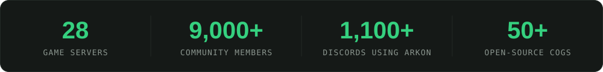
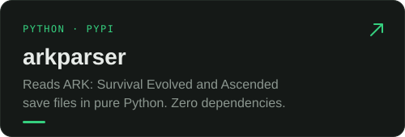

I write software for a living. Outside of work I run [Vertyco](https://vertyco.net), a crossplay ARK: Survival community I started in 2019, on servers I host and automate myself. I also built [Arkon](https://arkonbot.com), a public Discord bot that ARK server owners use to manage their servers.

### Open source

  
  
  
  

### Free tools

### Tools I use most

### Find me

  
  
  

